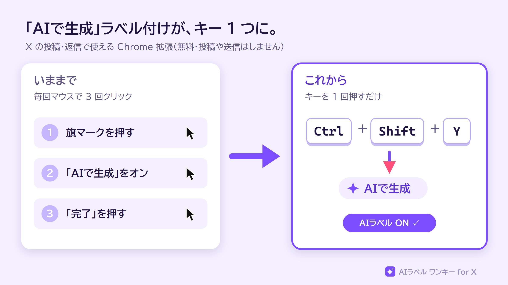
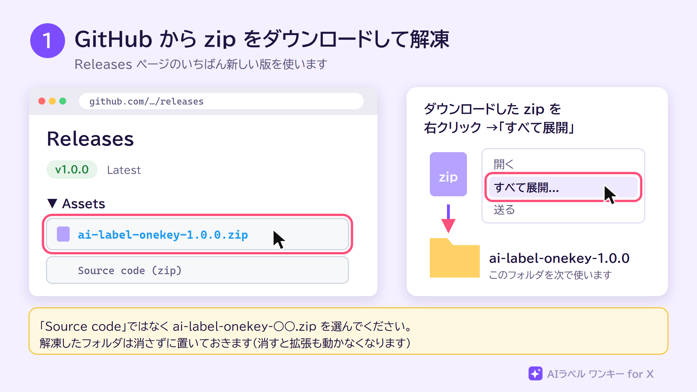
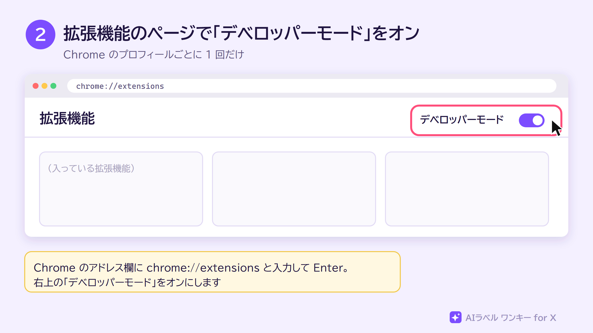
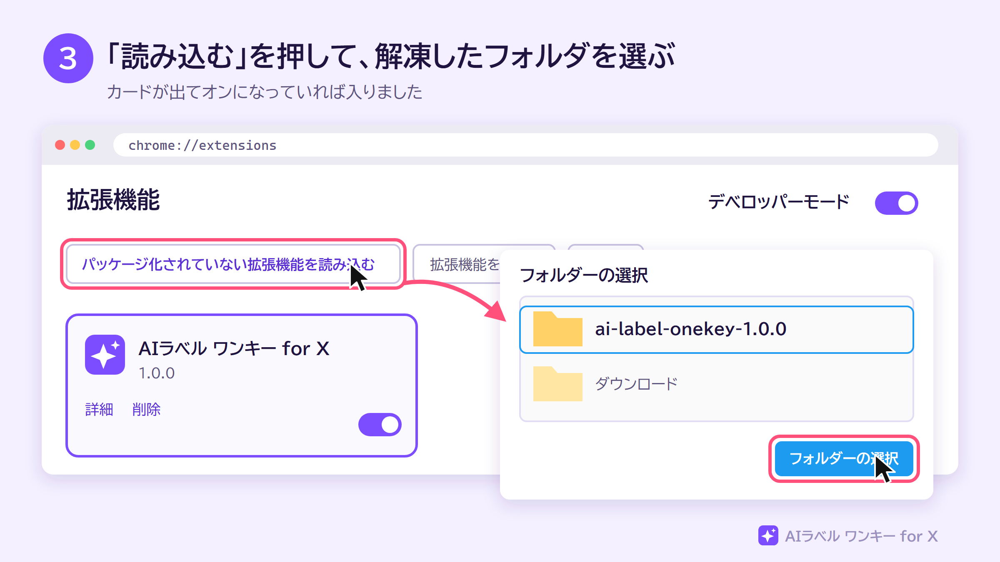
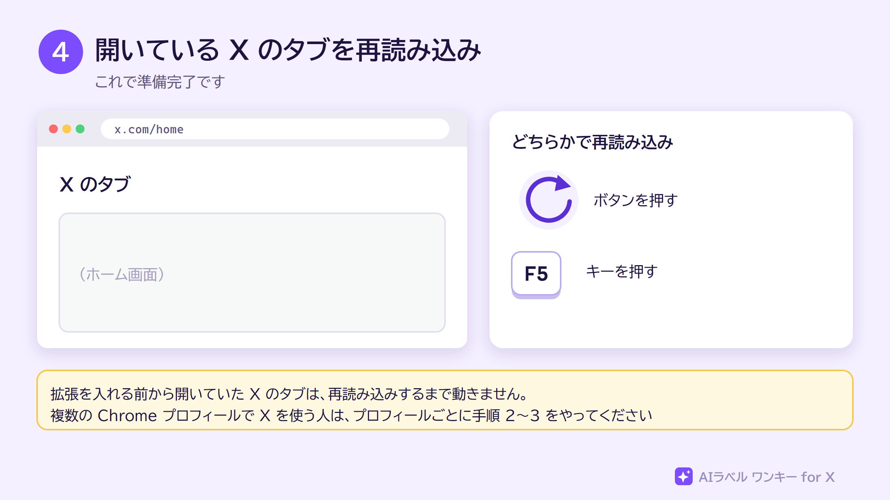
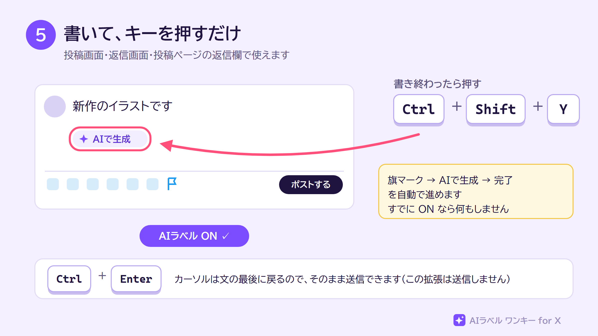
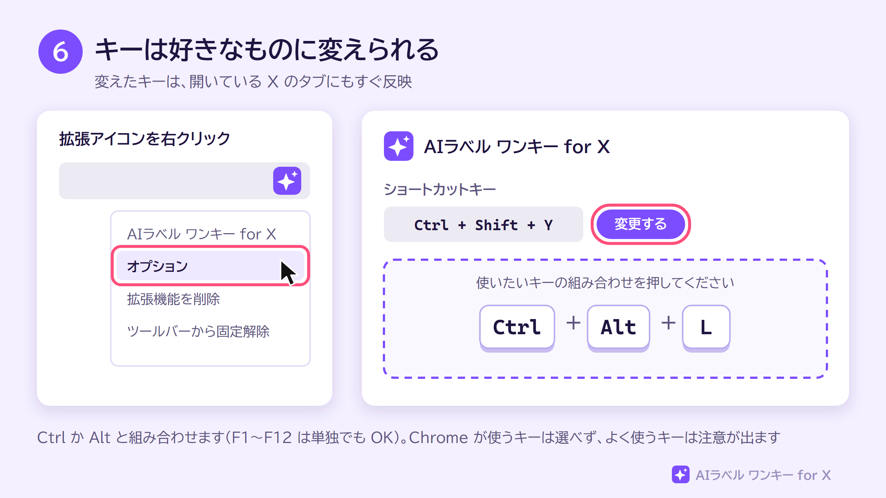
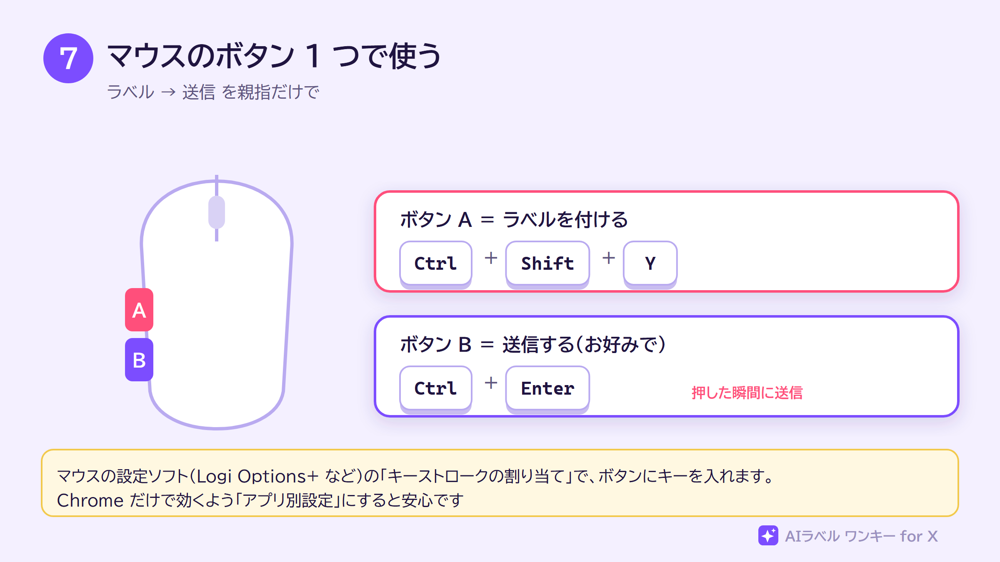
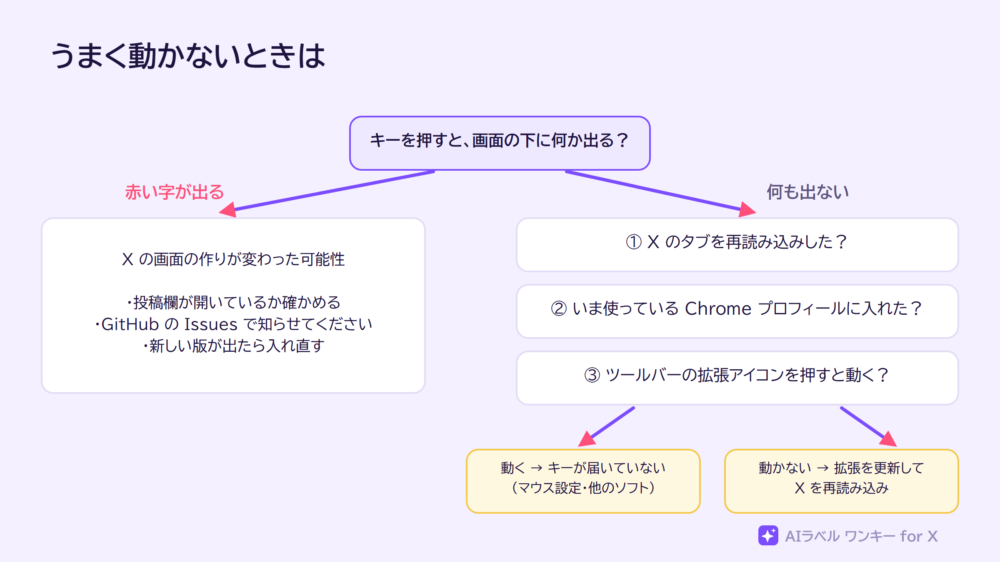

# AIラベル ワンキー for X

X（旧Twitter）の投稿・返信に、**キー 1 つで「AIで生成」ラベルを付ける** Chrome 拡張です。無料で使えます。

- 旗マーク →「AIで生成」をオン →「完了」の 3 クリックを、キー 1 つで自動で進めます
- キーは自由に変えられます（初期設定は <kbd>Ctrl</kbd> + <kbd>Shift</kbd> + <kbd>Y</kbd>）
- **投稿・送信は一切しません**。ラベルを付けるだけです
- 個人情報や投稿の内容を集めたり、外に送ったりしません（[プライバシーポリシー](PRIVACY.md)）

> [!NOTE]
> 個人が作った非公式の拡張です。X Corp. とは関係ありません。X の画面の作りが変わると、一時的に動かなくなることがあります。

---

## 入れ方（5 分）

Chrome ウェブストアには出していないので、zip をダウンロードして入れます。

### 1. zip をダウンロードして解凍

[**Releases**](../../releases/latest) を開き、`ai-label-onekey-○○.zip` をダウンロードします。ダウンロードしたら右クリック →「すべて展開」で解凍します。

> [!IMPORTANT]
> 解凍したフォルダは、消さずに置いておいてください。消すと拡張も動かなくなります。デスクトップやドキュメントなど、わかりやすい場所に置くのがおすすめです。

### 2. 「デベロッパーモード」をオン

Chrome のアドレス欄に `chrome://extensions` と入力して開き、右上の「デベロッパーモード」をオンにします。

### 3. 解凍したフォルダを読み込む

「パッケージ化されていない拡張機能を読み込む」を押して、手順 1 で解凍したフォルダを選びます。「AIラベル ワンキー for X」のカードが出て、オンになっていれば入りました。

### 4. X のタブを再読み込み

すでに開いている X のタブは、再読み込みすると使えるようになります。

> [!TIP]
> Chrome のプロフィールを分けて使っている人は、**X を使うプロフィールごとに**手順 2〜3 をやってください。拡張はプロフィールごとに入れる必要があります。

---

## 使い方

### 書いて、キーを押すだけ

投稿欄か返信欄に文章を書いて、<kbd>Ctrl</kbd> + <kbd>Shift</kbd> + <kbd>Y</kbd> を押します。画面の下に「AIラベル ON ✓」と出れば完了です。

- 使える場所：投稿画面（「ポストする」ボタンから開くダイアログ）、返信のダイアログ、投稿ページの返信欄
- すでにオンのときは何もしません（押しすぎてオフに戻ることはありません）
- 終わるとカーソルが文の最後に戻るので、そのまま <kbd>Ctrl</kbd> + <kbd>Enter</kbd>（X の送信キー）で送信できます
- ツールバーの拡張アイコンを押しても同じ動きをします
- 日本語入力がオンのままでも使えます

### キーを変える

拡張アイコンを右クリック →「オプション」で設定画面を開き、「変更する」を押してから使いたいキーを押します。

- <kbd>Ctrl</kbd> か <kbd>Alt</kbd> と組み合わせます（文字を打つときと区別するため）。<kbd>F1</kbd>〜<kbd>F12</kbd> は単独でも使えます
- <kbd>Ctrl</kbd> + <kbd>T</kbd> など、Chrome が先に使うキーは選べません
- <kbd>Ctrl</kbd> + <kbd>Enter</kbd> などふだん使われているキーは、選べますが注意が出ます
- 変えたキーは、開いている X のタブにもすぐ反映されます

### マウスのボタン 1 つで使う

マウスの設定ソフト（Logi Options+ など）の「キーストロークの割り当て」で、ボタンにこの拡張のキーを入れると、マウスのボタン 1 つでラベルを付けられます。

別のボタンに <kbd>Ctrl</kbd> + <kbd>Enter</kbd> を入れておけば「ラベル → 送信」を親指だけでできます。押した瞬間に送信されるので、押し間違えにくいボタンを選んでください。

---

## うまく動かないときは

| 画面の下に出る赤い字 | よくある原因 |
|---|---|
| 投稿欄・返信欄が見つかりません | 投稿画面・返信欄が開いていない |
| 旗マーク（コンテンツ開示）が見つかりません | X の画面の作りが変わった |
| 「AIで生成」のスイッチが見つかりません | X のメニューの作りや文字が変わった |

X の画面の作りが変わって動かなくなったときは、[Issues](../../issues) で教えてください。

## 新しい版に入れ替える

1. [Releases](../../releases/latest) から新しい zip をダウンロードして解凍する
2. `chrome://extensions` で古い「AIラベル ワンキー for X」を削除し、新しいフォルダを読み込む（手順 3）
3. X のタブを再読み込みする

※ 古いフォルダを新しい中身で上書きした場合は、`chrome://extensions` の更新ボタン（ぐるっと矢印）を押すだけで済みます。

## よくある質問

**Q. 勝手に投稿されたりしませんか？**
A. しません。この拡張がするのは「AIで生成」のスイッチをオンにすることだけで、投稿・送信・削除のボタンには触れません。中身はすべて公開しているので、だれでも確かめられます。

**Q. アカウントの情報を読まれませんか？**
A. 読みません。外部と通信する仕組みも入っていません。保存するのは、選んだキーなどの設定だけです（[プライバシーポリシー](PRIVACY.md)）。

**Q. X の規約的に大丈夫？**
A. この拡張は、あなたがキーを押したときに 1 回だけ、ふだん手で押しているボタンを代わりに押すものです。投稿の自動化・大量の操作・データの収集はしません。ただ、X の自動化ルールには「X のウェブサイトをスクリプトで操作する自動化をしないこと」という一文があり、この拡張が絶対に問題にならないとは言い切れません。心配な人は使わないでください。使う場合は自己責任でお願いします。

**Q. Edge や Brave でも使えますか？**
A. Chrome と同じ仕組みの拡張が使えるブラウザなら、たぶん動きます（確かめているのは Chrome だけです）。

## ライセンス

[MIT License](LICENSE)

開発者向けのメモ（ファイルの役目・zip の作り方・イラストの作り直し方）は [docs/DEVELOPMENT.md](docs/DEVELOPMENT.md) にあります。
